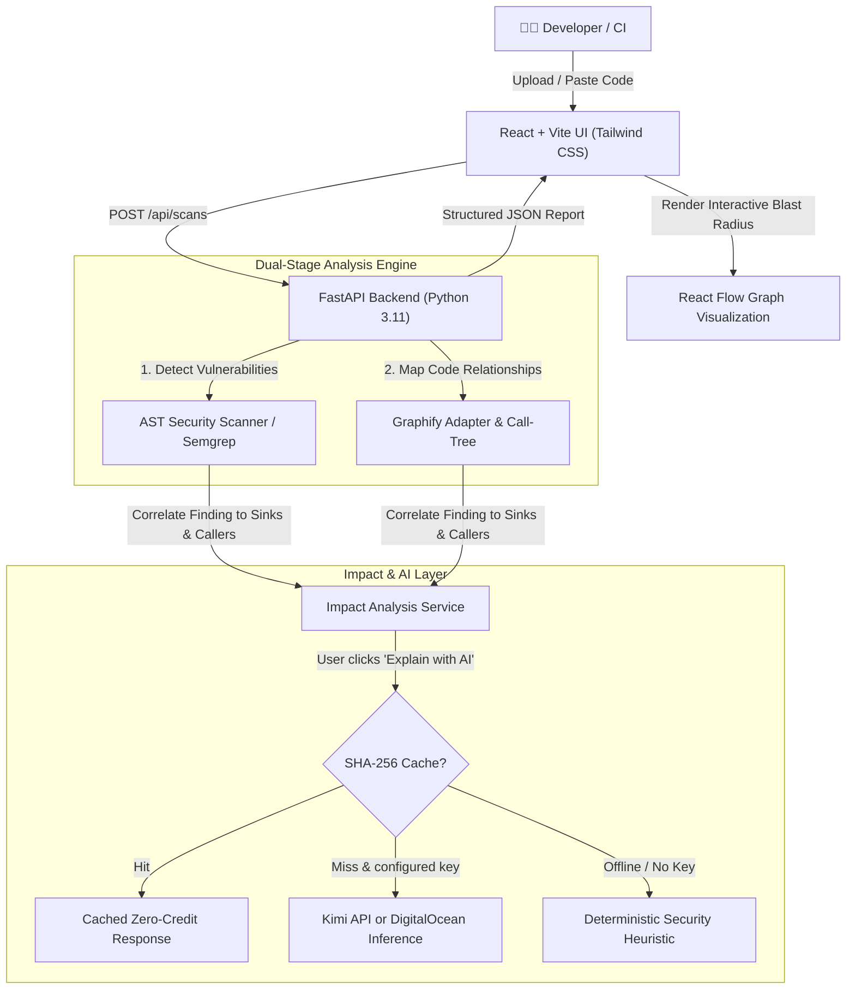

# CodeShield AI 🛡️⚡
> **Developer Security & Change-Impact Console**  
> Powered by Static AST Scanning, Graphify Code Knowledge Graphs, and Kimi or DigitalOcean AI inference.

---

## 🌟 Executive Overview

**CodeShield AI** bridges the gap between vulnerability detection and actionable architectural remediation. Rather than overwhelming developers with isolated lists of file warnings, CodeShield AI:
1. **Detects High-Risk Flaws**: Identifies SQL injections, command execution sinks, hardcoded credentials, and insecure deserialization using static AST and Semgrep pattern matching.
2. **Maps Downstream Blast Radius via Graphify**: Traces calling controllers, middleware filters, and database dependencies so you immediately see which routes expose the vulnerability.
3. **Explains & Fixes with AI**: Grounds remediation in scanner evidence using the Kimi/Moonshot API or DigitalOcean Serverless Inference.
4. **Optimizes API Usage**: Enforces strict on-demand inference, SHA-256 deduplication caching, and a per-scan call limit.

---

## 🏛️ System Architecture



---

## 💰 AI Usage Safeguards

AI explanations are user-triggered and protected with caching and request limits:

| Safeguard | How It Works | Credit Impact |
| :--- | :--- | :--- |
| **On-Demand Triggering** | Bulk scans do not invoke AI automatically. Users click **Explain with AI** only on findings needing reasoning. | Avoids unnecessary calls |
| **SHA-256 Response Cache** | Queries are hashed by finding rule, file, line, code context, provider, and model. | Cached requests consume no additional API tokens |
| **Concise Grounded Prompts** | Prompts send only affected code context and scanner evidence with strict output limits. | Limits prompt and response size |
| **Per-Scan Call Limit** | The backend caps automated explanations per scan. | Helps limit usage |
| **Local Fallback** | If no key is configured or an API request fails, a deterministic security heuristic provides a fallback. | No API call required |

---

## 🚀 Quick Start Guide

### 1. Run the Frontend (React + Vite)
```bash
cd frontend
npm install
npm run dev
```
Open **[http://localhost:5173](http://localhost:5173)** in your browser.  
The UI loads immediately with rich mock findings and an interactive React Flow impact graph.

---

### 2. Run the Backend (Python + FastAPI)
```bash
cd backend
python -m venv .venv
# Windows PowerShell:
.\.venv\Scripts\Activate.ps1
# Or Command Prompt:
.venv\Scripts\activate.bat

pip install -r requirements.txt
uvicorn app.main:app --reload --port 8000
```
- Interactive Swagger API Docs: **[http://127.0.0.1:8000/docs](http://127.0.0.1:8000/docs)**
- Health Check: **[http://127.0.0.1:8000/api/health](http://127.0.0.1:8000/api/health)**

---

### 3. Configure Kimi API (Optional)
The backend loads API keys from `backend/.env`. This file is ignored by Git and must never be copied into frontend code or committed. The repository includes `backend/.env.example` as a template. Add a rotated Kimi API key to `backend/.env`:
```env
MOONSHOT_API_KEY=your_rotated_kimi_api_key
MOONSHOT_API_BASE_URL=https://api.moonshot.ai/v1
MOONSHOT_MODEL=kimi-k3
```
When both Kimi and DigitalOcean keys are configured, the backend uses Kimi. Otherwise it uses DigitalOcean if configured, or the local fallback. Restart the backend after changing `.env`.

To use DigitalOcean instead, configure `DIGITALOCEAN_INFERENCE_KEY`, `DIGITALOCEAN_MODEL`, and `DIGITALOCEAN_INFERENCE_URL` in the same backend `.env` file.

---

## 📂 Project Structure

```
CodeShieldAi/
├── frontend/                     # React 19 + Vite + Tailwind CSS
│   ├── src/
│   │   ├── components/
│   │   │   ├── Sidebar.jsx       # Brand navigation & credit widget
│   │   │   ├── Topbar.jsx        # Project context & scan status
│   │   │   ├── StatCard.jsx      # Metric cards with severity badges
│   │   │   ├── ScanForm.jsx      # Code editor, upload & presets
│   │   │   ├── FindingsTable.jsx # Filterable findings table
│   │   │   ├── FindingDetails.jsx# Inspector drawer & DO AI explanation
│   │   │   ├── ImpactGraph.jsx   # Interactive React Flow blast radius
│   │   │   └── CreditOptimizerModal.jsx # DO token budget manager
│   │   ├── pages/
│   │   │   ├── Dashboard.jsx     # High-level overview
│   │   │   ├── NewScan.jsx       # Submit code & test presets
│   │   │   ├── Findings.jsx      # In-depth inspection & fix copying
│   │   │   ├── ImpactAnalysis.jsx# Graphify blast radius explorer
│   │   │   └── ScanHistory.jsx   # Past scans & credit audit trail
│   │   ├── data/mockFindings.js  # Realistic security findings & graphs
│   │   └── services/api.js       # Backend communication with fallback
├── backend/                      # Python FastAPI Service
│   ├── app/
│   │   ├── main.py               # FastAPI entry point & CORS
│   │   ├── config.py             # DO Inference & token settings
│   │   ├── api/routes.py         # Endpoints for scans, findings, graphs
│   │   ├── schemas/scan.py       # Pydantic request & response contracts
│   │   ├── security/file_safety.py # Safe temporary workspace isolation
│   │   └── services/
│   │       ├── scanner_service.py# AST & Semgrep vulnerability analyzer
│   │       ├── graphify_service.py # Graphify relationship adapter
│   │       ├── impact_service.py # Upstream/downstream impact tracer
│   │       ├── ai_service.py     # DO Serverless Inference & SHA-256 cache
│   │       └── scan_service.py   # Complete scan orchestrator
│   ├── tests/                    # Pytest test suite
│   ├── .env.example
│   └── requirements.txt
└── sample-projects/              # Safe test fixtures (vulnerable_app.py)
```

---

## 🛡️ License
MIT License. Built for developers building secure software.
